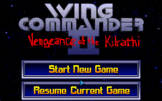
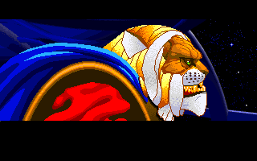
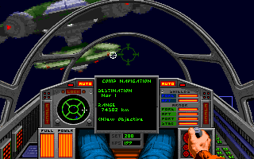
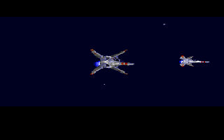
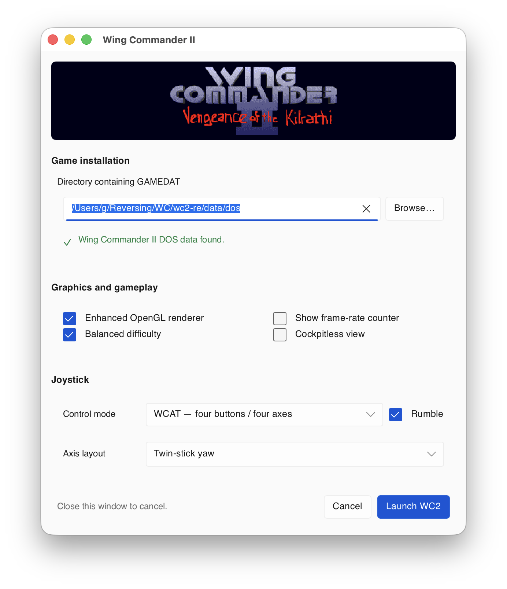
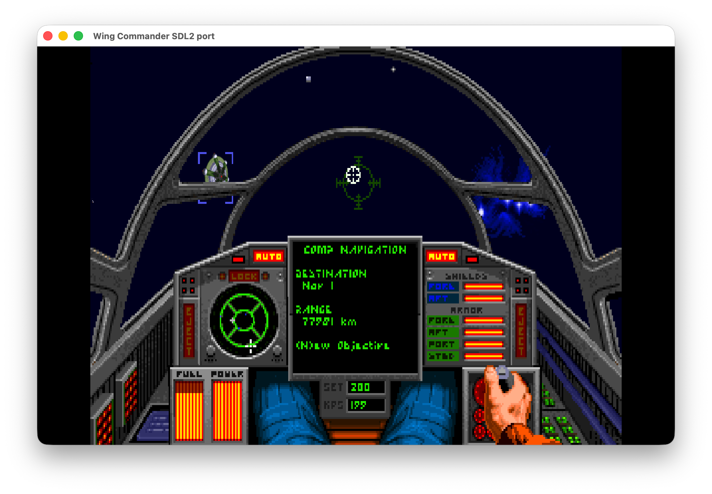
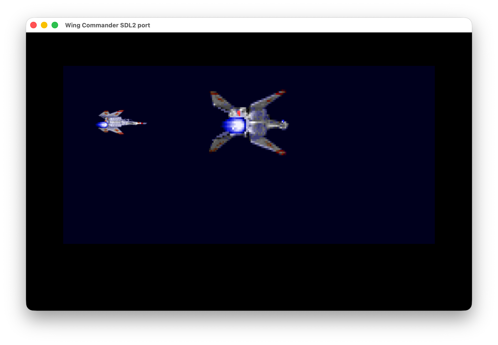

# Wing Commander II source reconstruction and SDL2 port

This project recreates the source of **Wing Commander II** as shipped in *Wing
Commander: The Kilrathi Saga* (1996). The C game core and C++ `ix` audio
library rebuild with Microsoft Visual C++ 4.1 into a **byte-identical
`WC2.EXE`**: all 714,752 bytes match the retail executable.

A native SDL2 port and optional graphical launcher are available for Windows,
Linux, and macOS. The port supports game data from the **original DOS release**
(partial support), the **Windows release (Kilrathi Saga)**, and the
**35th Anniversary Edition**.

Built from the **reconstructed original source**, the port adds **no new graphics**
and keeps **savegames compatible with the original game**.

No retail game data files are included.

Browse the [reconstructed Win32 source](https://neuromancer.github.io/wc2-re/),
including assembly listings and searchable references.

Players and modders are invited to discuss wc2-re in the `#wc1-re` channel of
the [Wing Commander Dev Discord](https://discord.gg/p8aKxvWKq).

If you find this project useful, you can [support its development through
GitHub Sponsors](https://github.com/sponsors/neuromancer).

## Screenshots

The game captures were taken through DREAMM at the original 320x200
resolution.

| Title menu | Opening sequence |
| --- | --- |
| [](screenshots/title-screen.png) | [](screenshots/kilrathi-intro.png) |

| Cockpit navigation | External flight sequence |
| --- | --- |
| [](screenshots/cockpit-navigation.png) | [](screenshots/external-flight.png) |

## Download and run the SDL2 port

Download the archive for your platform from
[GitHub Releases](https://github.com/neuromancer/wc2-re/releases), extract it,
and keep the bundled runtime libraries beside `wc2-modern` (`wc2-modern.exe`
on Windows). Starting without arguments opens the graphical launcher. It
detects common WC2 installations, including Heroic, GOG, and Steam libraries;
use **Add path…** for another directory containing `GAMEDAT`. Choose an
installation and select **Start WC2**. The launcher remembers your settings.
Enable **Start in fullscreen** under **Graphics** to open the game in desktop
fullscreen mode.

**Steam Deck / Linux:** install the `.flatpak` in Desktop Mode with
`flatpak install --user ./downloaded.flatpak` (replace the filename), then add
**Wing Commander II** to Steam as a non-Steam game. In Game Mode the launcher
fills the screen, with its settings and controls in tabs and the joystick
calibration in the same window. Install newer bundles the same way; automatic
app updates are not configured.

Select **Start SO1** in the launcher, or pass `--campaign=so1`, to play SO1.
The **Start SO1** button appears only when the selected installation contains
the required expansion files alongside the base game's `GAMEDAT` files.
`--campaign=wc2` selects the base campaign.
SO1 uses **SAVEGAME.SO1** and separate temporary state; base-game saves remain
in **SAVEGAME.WC2**. Starting a new SO1 campaign offers to transfer the pilot
from your WC2 Continue checkpoint. SO1 currently uses English campaign dialogue
and original AdLib music, including with Kilrathi Saga data.
SO1 support is experimental; remaining original-game anomalies are tracked in
[#8](https://github.com/neuromancer/wc2-re/issues/8) and
[#9](https://github.com/neuromancer/wc2-re/issues/9).

Select **Start SO2**, or pass `--campaign=so2`, to play SO2. Its launcher button
appears only when the required expansion data is detected. SO2 includes the
Morningstar's **Mace weapon** and original explosion graphics, uses
**SAVEGAME.SO2** and separate temporary state, and offers to transfer your SO1
Continue pilot (or WC2's if no valid SO1 checkpoint exists). Campaign dialogue
is English, with original AdLib music. **SO2 support is experimental**: all
mission starts, navigation entries and default cutscene sequences pass
sanitizer checks, but a full campaign playthrough remains unverified.

Choose **Language → Español** or **Language → Polski** for Spanish or Polish
dialogue, menus, game UI and launcher text, or use `--language=es` or
`--language=pl` (`--language=en` restores English). Both translations work
with DOS or Kilrathi Saga data; Polish also covers SO1 and SO2. See
[translations](translations/README.md) for coverage and editing instructions.

A DOS installation you have patched yourself with the German translation
(`wc2en2de`) shows its German text, including the menus and cockpit messages
of its German `WC2.EXE`. The launcher's **Language** menu then shows
**German** only, and some artwork may stay in English.

Command-line arguments start the game directly from the working directory;
add `--gui` to open the launcher first:

```sh
cd /path/to/WC2
/path/to/wc2-modern --enhanced --joystick-rumble
```

Use `--fullscreen` or `--windowed` to choose the startup display mode. With
`--gui`, these also override the saved fullscreen setting in the launcher.

WC2 automatically saves a **Continue** checkpoint. Starting a new campaign
asks **Overwrite Continue save? (Y/N)** if that checkpoint is occupied.
Press **Y** to proceed, or **N** or **Esc** to keep it and return to the title menu.

<p align="center">
  <a href="screenshots/graphical-launcher.png"></a>
</p>

### Fixes and features

The port includes resizable, aspect-correct display, gamepad hot-plug support,
rebindable keyboard and mouse controls, mouse-wheel throttle, cinematic
captions, subtitles for spoken in-flight messages, corrected planet scaling, and static on damaged cockpit displays. DOS data uses AdLib music and synthesized OriginFX
sound effects. Optional features can be combined:

| Fix or feature | Enable with |
| --- | --- |
| Start in fullscreen | Launcher checkbox or `--fullscreen` |
| Neutral adaptive difficulty and half-size asteroid collision radii | `--balanced-difficulty` |
| Cheat mode: invulnerability and no collisions | Launcher checkbox or `--cheats` |
| OpenGL space objects rendered at output resolution | `--enhanced` |
| Authentic 16-colour EGA dithering from the DOS installer | `--ega` |
| Experimental: cockpit text, nav labels, HUD messages and radio subtitles in the game's larger 11-pixel font, with the enhanced renderer | Launcher checkbox or `--hires-hud` |
| Smooth spaceflight: frames drawn between the game's steps at the display's refresh rate, one step behind the game | Launcher checkbox or `--interpolate` |
| Game speed: spaceflight's frame rate, 8 to 32 FPS (20 by default) | Launcher **Speed**, `[` and `]` in flight, or `--flight-fps=N` |
| Heavy-weapon, damage, collision, and afterburner rumble | `--joystick-rumble` |
| WCAT-style four-button joystick layouts | `--joystick-mode=4button-2axis` or `4button-4axis` |
| Rebind gamepad buttons, triggers and axes, or a flight stick’s own inputs | Launcher **Custom** control mode or `--joystick-mode=custom` |
| Steam Deck preset with a front/rear control diagram | Launcher **Steam Deck** control mode or `--joystick-mode=steam-deck` |
| Twin-stick, HOTAS, throttle, and rudder layouts | `--joystick-axes=<layout>` |
| Joystick dead zone, 0% to 33% of the stick's travel (22%, the original's, by default) | Launcher slider or `--joystick-dead-zone=N` |
| Joystick calibration that writes `GAMEDAT/j.cal` as the game's own does; the game now reads all of that file, not only the centre | Launcher **Calibrate…** |
| Joystick diagnostics on stderr | `--joystick-debug` |
| Frame-rate counter in the window title | `-f` |
| Cockpitless view | `-c` |

**Steam Deck preset:** follows the layout shared in [#66](https://github.com/neuromancer/wc2-re/issues/66),
with roll/speed on the left stick and yaw/pitch on the right. Native rear
buttons mirror the D-pad: L4 = up (navigation/map), L5 = down (damage),
R4 = left (communications), R5 = right (lock target). With Steam Input,
assign those same directions to the rear buttons in Steam's controller
layout. The individual paddle order is a POC choice; the reporter specified
mirroring the D-pad without specifying the order. Selecting this optional
preset is saved across sessions and preserves existing Custom bindings,
dead zone, calibration and rumble settings.

**Music and sound effects:** the launcher's **Music** and **Sound** menus
choose each on its own. A *Kilrathi Saga* installation offers its own
**Digital** music and effects, or the DOS ones on an **AdLib** or a
**Roland MT-32**; a DOS installation offers the AdLib and the MT-32.

**Game speed:** spaceflight advances one step per frame, so its frame rate
sets the game's speed. The launcher's **Speed** offers **Normal** (20 FPS) and
**Slow** (15 FPS, the pace of the *Kilrathi Saga*'s own WC2). In flight, `[`
and `]` (the two keys right of `P`) lower and raise the rate in half steps
from 8 to 32 FPS, as the *Kilrathi Saga*'s `Alt+N` and `Alt+M` did; the
launcher keeps that rate and offers it as **Custom**. The command line takes
`--flight-fps=N`.

**Mission fixes:** three bugs that the DOS and *Kilrathi Saga* releases share
are fixed ([#9](https://github.com/neuromancer/wc2-re/issues/9)). A cloaked
ship decloaked only by firing, so one that stopped attacking stayed invisible
for the rest of the mission and kept autopilot refused; a cloak now ends after
a minute without firing, and the ship stays visible for half a minute before
it can cloak again. Passing a nav point no longer counts as reaching a later
return to it, so *Special Operations 1* series 1 mission 4 leads back to
Rigel's jump point instead of pointing at the other system. A scene waiting for
a nav point's fight to end, such as the bomb at Nav3 in *Special Operations 2*
series 2 mission 3, plays only when that fight ends, not the next one
elsewhere.

**Wing Commander I pilots:** as in the original, a new game's personnel
database can transfer a WC1 pilot (**[T]ransfer an existing personnel
file**): it keeps the last name, callsign, missions and kills, asks for a
first name (Christopher by default), and makes the pilot a captain.
**[W]ing Commander** reads the saved games of the WC1 that
[wc1-re](https://github.com/neuromancer/wc1-re)'s launcher plays, or of a
*Kilrathi Saga* WC1 beside this install, as GOG puts Wing Commander I beside
Wing Commander II. **[D]os Version of Wing Commander** reads a DOS WC1's beside
it, or asks for that game's folder.

**Roland MT-32:** the DOS music and effects can play on an emulated MT-32 or
CM-32L, as WC2 plays its Roland scores (`MUSIC.R00`, and `R01`/`R02` for the
*Special Operations*). Put your own control and PCM ROM files in a folder,
choose **Roland MT-32** under **Music** or **Sound** in the launcher, and
select the folder with **MT-32 ROMs…**, which appears with it. The launcher
names the machine it found, preferring the CM-32L. Music and effects on one
MT-32 share its channels as the original does. Without usable ROMs the AdLib
plays instead. The command line takes `--music=default|adlib|mt32`,
`--sound=default|adlib|mt32`, `--mt32-roms=DIR`, `--mt32-model=ID` (such as
`mt32_1_07`) and `--mt32-check`, which reports what a ROM folder holds.
Without `--sound`, the effects follow MT-32 music onto the MT-32.

The enhanced renderer keeps the original artwork, palettes, cockpit, and HUD;
only space objects are redrawn at output resolution. Combining it with `--ega`
uses the original-resolution scene so dithering applies consistently.

| Cockpit flight | External flight sequence |
| --- | --- |
| [](screenshots/enhanced-cockpit-flight.png) | [](screenshots/enhanced-space-objects.png) |

### Controls

| Shortcut | Action |
| --- | --- |
| `Cmd+Enter` (macOS), `Alt+Enter` (Windows and Linux) | Toggle fullscreen |
| `Cmd+Q` (macOS) | Quit the game |
| Mouse wheel (spaceflight) | Increase or decrease speed |
| `[` / `]` (spaceflight) | Slow the game down / speed it up (the frame rate, 8 to 32 FPS) |
| `Esc` (spaceflight) | Close communications, or pause |
| `Esc` (autopilot fly-by) | Skip the fly-by |
| Gamepad RT / LT (spaceflight) | Same as A / B: fire guns / roll and speed (missiles in the WCAT layouts) |
| Gamepad Start (spaceflight) | Pause or resume |
| Gamepad Back | Cycle views in spaceflight; Escape/back during the fly-by and elsewhere |
| Gamepad Y (`Y/N` prompts) | Confirm Yes |
| `Ctrl+J` or `Alt+C` (menus and spaceflight) | Calibrate the joystick, as in the original |

The launcher's **Joystick** and **Keyboard and mouse** tabs show every
binding. Click a key or mouse input to change it, or **+** to add a second one;
changes apply when the game starts. Wingman orders such as `Alt+A` can move to single keys. `Esc` and
the communication message keys `1`–`9` cannot be changed.

Pause (`P` or Gamepad Start) and quit controls remain available during
autopilot.

The default joystick mode retains the original two-axis, two-button controls.
When several devices are connected, the launcher's **Device** selector chooses
the primary joystick for that session. **Automatic** gives free slots to gamepads
and flight sticks first, then unknown devices, then throttles, wheels and other
controllers. Calibration uses the same order.
A joystick chosen there is joystick 1: the game applies a `j.cal` calibration
only to it, and the launcher's calibration offers only it. If it disconnects,
another device can take over until the selected joystick reconnects.
The optional four-button modes add afterburner, targeting, weapons, navigation,
autopilot, communications, and speed controls. Axis layouts are
`twin-stick-roll`, `twin-stick-yaw`, `hotas-yaw`, `hotas-roll`,
`linear-throttle`, `rudder-yaw`, and `rudder-roll`.

Choose **Custom — your own bindings** on the **Joystick** tab to change each
input. **Source** selects **Automatic**, **Gamepad**, **Steam Deck** or **Joystick**.
Automatic follows the connected device. Gamepad and Steam Deck show editable
diagrams; the Deck's rear buttons share the D-pad bindings. Joystick lists
numbered inputs, even for devices recognized as gamepads: up to 32 buttons, two hats and
eight axes, with axis names when the operating system supplies them. Held
inputs light up; pressing a button or hat direction opens its action chooser,
and clicking an input does the same. Buttons can use WC2 flight actions,
including hyperjump and radio commands, cycle the views, or act as a held
roll-and-speed modifier. Axes can pitch, yaw, roll, change speed or set the
throttle position, with optional reversal; gamepad triggers can use either
button actions or analog functions.

Custom starts from the four-button, four-axis layout, using named stick,
twist and throttle axes where available. **Restore defaults** restores the
displayed input family's bindings, using the Deck preset when that source is
selected. Switching sources preserves edits; Gamepad and Steam Deck share
their bindings, while numbered joystick inputs have separate bindings.
The launcher saves the mode, source and bindings in `wc2-launcher.ini` when
starting the game, including bindings kept while another mode is selected.
Menus retain their usual controls, and the first
hat or D-pad still navigates the communications display.

## Build from source

Clone the submodules first:

```sh
git submodule update --init --recursive
```

### SDL2 port

Install a C/C++ compiler plus the SDL2 and LZO2 development packages, then run
`make -j modern`. The executable is written to `out-modern/wc2-modern` (`.exe`
on Windows). `make run-modern` uses Kilrathi Saga data in `data/wc2-full`;
`make run-modern-dos` uses DOS data in `data/dos`.

For regression checks, `make modern-test-cutscenes` runs the 50 populated
base-campaign cutscene sequences with SDL's dummy video and audio drivers,
including mission-data loads reached by briefing scripts. Set `MODERN_RUN_DIR`
to the installed game directory and `MODERN_CUTSCENE_JOBS=1` for a serial run
(default: four parallel processes). Logs go to `out-modern/cutscene-asan/`;
the command fails on process errors or sanitizer reports. Full flight startup
is separate: `make run-modern-mission SERIES=1 MISSION=0`.
Set `CAMPAIGN=so1` or `CAMPAIGN=so2` for either expansion's 20 mission
sequences or direct flight, and
`CUTSCENE_PHASE=postflight` to test debriefings instead of preflight scenes.

To fuzz spaceflight with libFuzzer (Clang with libFuzzer support, such as
Homebrew's LLVM on macOS), use:

```sh
make check-fuzz GAME_DATA=/path/to/WC2 FUZZ_ARGS='-- -max_total_time=3600'
make check-fuzz-so1 SO1_DATA=/path/to/WC2 FUZZ_ARGS='-- -max_total_time=3600'
make check-fuzz-so2 SO2_DATA=/path/to/WC2 FUZZ_ARGS='-- -max_total_time=3600'
```

This adapts WC1's flight fuzzer to WC2, SO1 and SO2 with DOS or Saga data.
Each input picks a mission, a start (later flight-path legs, a nav point or
the cockpit) and a sequence of flight controls. The runner copies assets into
a temporary installation, keeps the corpus and crash inputs under
`out-modern/fuzz/`, and prints a replay command. See
[flight fuzzing and findings](src/sdl/FLIGHT_TESTS.md) for the input format,
replaying a failure, and coverage limits.

The graphical launcher (`make -j modern-gui`) also needs CMake 3.21+, Rust
1.92+, and a C++20 compiler. Linux builds need the D-Bus and Fontconfig
development packages. It produces `out-modern/wc2-modern-gui`, which release
archives ship as `wc2-modern`.

For installer builds, see the [macOS packaging instructions](packaging/README-macos-build.txt)
or [Windows packaging instructions](packaging/README-windows-build.txt).

### Reconstructed Win32 build

With Python 3.10+ installed, run:

```sh
python3 -m venv .venv
. .venv/bin/activate
python3 -m pip install -r requirements-build.txt
make -j
```

The build downloads the MSVC 4.1 toolchain and runs it under
[`wibo`](https://github.com/neuromancer/wibo). It verifies `WC2.EXE` against
the retail SHA-256 and fails on any mismatch, even for an up-to-date build.
The original executable is not needed to compile it.

To run it, provide a Kilrathi Saga disc image. The Makefile substitutes the
reconstructed executable and launches it under DREAMM:

```sh
make run ISO=/path/to/kilrathi-saga.iso
```

Use `make run-original` for the retail executable in the same environment, and
`make debug` to start DREAMM's debugger.

## Source browser

The [source browser](https://neuromancer.github.io/wc2-re/) shows the matching
Win32 sources with SDL-only branches removed. To build it locally, install
Doxygen 1.18.0, `unifdef`, and Pygments, run `make site`, and open
`out/site/html/index.html`.

## Reconstruction workflow

[`binary-comp`](https://github.com/gg-sl-oss/binary-comp) also provides
comparison and verification commands. Install its optional analysis dependencies:

```sh
python3 -m pip install -r requirements-build.txt "capstone>=5" "tree-sitter>=0.20" "tree-sitter-cpp>=0.20"
make compare-func FUNC=WinMain
make compare-bytes
make verify
```

These look for the retail executable at `../releases/win32/WC2.EXE`; set
`ORIGINAL_SRC` to point elsewhere.

## Acknowledgements

Special thanks to:

- [Origin Systems](https://en.wikipedia.org/wiki/Origin_Systems), who created
  *Wing Commander II* and developed its *Kilrathi Saga* port;
- [Electronic Arts](https://www.ea.com/) for publishing *Wing Commander: The
  Kilrathi Saga* and releasing *Wing Commander II: Vengeance of the Kilrathi:
  35th Anniversary Edition*;
- digital game stores ([GOG](https://www.gog.com/en/game/wing_commander_ii_vengeance_of_the_kilrathi_35th_anniversary_edition) and
  [Steam](https://store.steampowered.com/app/2008730/Wing_Commander_II_Vengeance_of_the_Kilrathi_35th_Anniversary_Edition/))
  for keeping *Wing Commander II* readily available;
- AllTinker for the [W.C.A.T. overhaul](https://alltinker.itch.io/wcat), whose
  fixes and analysis of the DOS release have been valuable references;
- the [WCDX project](https://github.com/Bekenn/wcdx) for its pioneering
  compatibility work on the *Kilrathi Saga* release;
- L@Zar0 for creating the Spanish translation and darkpadawan for reviewing
  its text, shared under the [upstream GPL v3.0 notice](translations/upstream/Leeme.txt);
  their Spanish version was also the base of the Polish translation;
- paxiu1984 for creating the Polish translation of *Wing Commander II* and
  both *Special Operations*, shared under its
  [upstream GPL v3.0 notice](translations/upstream/Polish-credits-and-license.txt),
  and the [clandlan.net](https://www.clandlan.net/) and
  [wcnews.com](https://www.wcnews.com/) communities that tested it;
- Aaron Giles for the [DREAMM emulator](https://dreamm.aarongiles.com/), used
  to run and study the original release, and
  [ymfm](https://github.com/aaronsgiles/ymfm), which powers the SDL2 port's
  AdLib emulation;
- the [Munt project](https://github.com/munt/munt), whose libmt32emu
  (LGPL-2.1 or later) emulates the Roland MT-32 and CM-32L; and
- DaisenryakuFan for providing very advanced source reconstructions for the DOS releases of several Wing Commander titles.

## License

This project is licensed under the GNU General Public License version 3
(GPLv3). See [LICENSE](LICENSE) for the full text.

OpenAI Codex and Anthropic Claude were used during the reconstruction.
