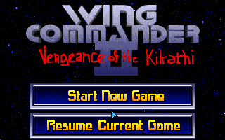
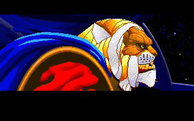
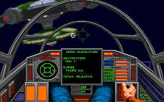
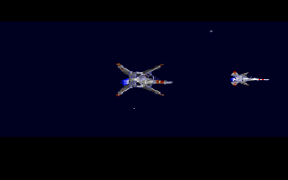
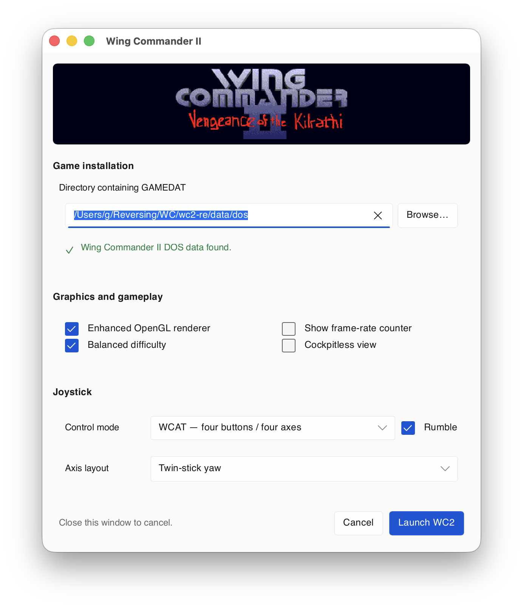
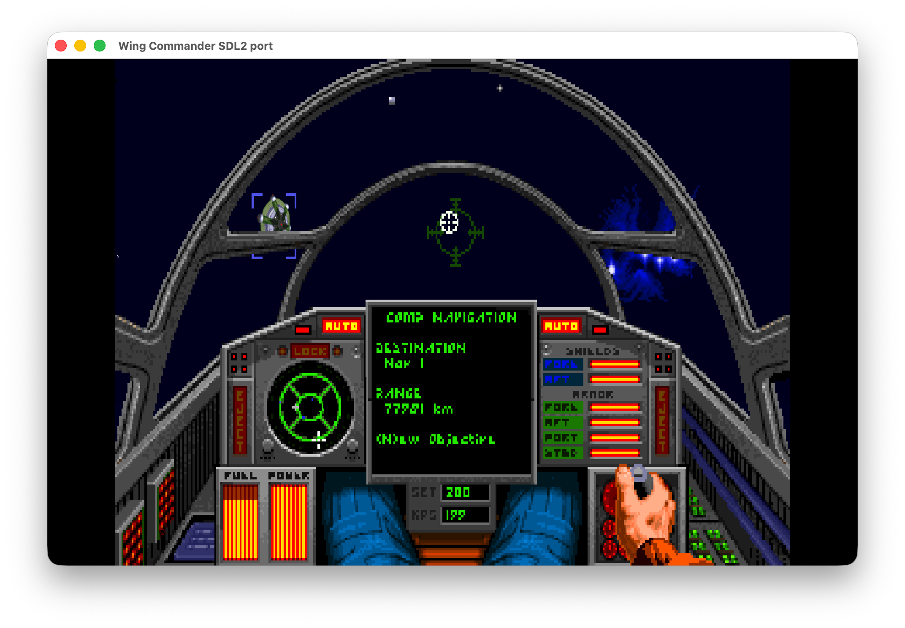
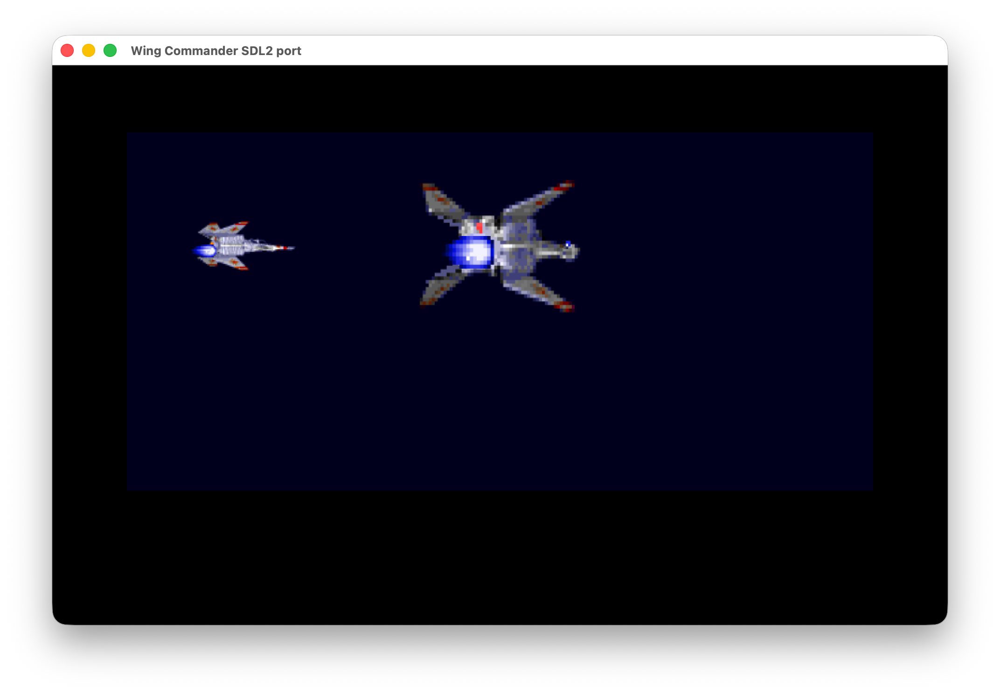

# Wing Commander II source reconstruction and SDL2 port

This project recreates the source of **Wing Commander II** as shipped in *Wing
Commander: The Kilrathi Saga* (1996). The C game core and C++ `ix` audio
library rebuild with Microsoft Visual C++ 4.1 into a **byte-identical
`WC2.EXE`**: all 714,752 bytes match the retail executable.

A native SDL2 port and optional graphical launcher are available for Windows,
Linux, and macOS. They support Kilrathi Saga data and have partial support for
the original DOS game data.

No retail game data files are included.

Browse the [reconstructed Win32 source](https://neuromancer.github.io/wc2-re/),
including assembly listings and searchable references.

If you find this project useful, you can [support its development through
GitHub Sponsors](https://github.com/sponsors/neuromancer).

## Screenshots

The game captures were taken through DREAMM at the original 320x200
resolution.

| Title menu | Opening sequence |
| --- | --- |
| [](screenshots/title-screen.png) | [](screenshots/kilrathi-intro.png) |

| Cockpit navigation | External flight sequence |
| --- | --- |
| [](screenshots/cockpit-navigation.png) | [](screenshots/external-flight.png) |

## Download and run the SDL2 port

Download the archive for your platform from
[GitHub Releases](https://github.com/neuromancer/wc2-re/releases), extract it,
and keep the bundled runtime libraries beside `wc2-modern` (`wc2-modern.exe`
on Windows). Starting without arguments opens the graphical launcher. It
detects common WC2 installations, including Heroic, GOG, and Steam libraries;
use **Add path…** for another directory containing `GAMEDAT`. Choose an
installation and select **Start game**. The launcher remembers your settings.
Enable **Start in fullscreen** under **Graphics** to open the game in desktop
fullscreen mode.

Choose **Language → Español** for Spanish dialogue, menus, game UI and
launcher text, or use `--language=es` (`--language=en` restores English).
Translations support the base game with DOS or Kilrathi Saga data. See
[translations](translations/README.md) for coverage and editing instructions.

Command-line arguments start the game directly from the working directory;
add `--gui` to open the launcher first:

```sh
cd /path/to/WC2
/path/to/wc2-modern --enhanced --joystick-rumble
```

Use `--fullscreen` or `--windowed` to choose the startup display mode. With
`--gui`, these also override the saved fullscreen setting in the launcher.

WC2 automatically saves a **Continue** checkpoint. Starting a new campaign
asks **Overwrite Continue save? (Y/N)** if that checkpoint is occupied.
Press **Y** to proceed, or **N** or **Esc** to keep it and return to the title menu.

<p align="center">
  <a href="screenshots/graphical-launcher.png"></a>
</p>

### Fixes and features

The port includes resizable, aspect-correct display, gamepad hot-plug support,
mouse-wheel throttle, cinematic captions, corrected planet scaling, and static
on damaged cockpit displays. DOS data uses AdLib music and synthesized OriginFX
sound effects. Optional features can be combined:

| Fix or feature | Enable with |
| --- | --- |
| Start in fullscreen | Launcher checkbox or `--fullscreen` |
| Neutral adaptive difficulty and half-size asteroid collision radii | `--balanced-difficulty` |
| Cheat mode: invulnerability and no collisions | Launcher checkbox or `--cheats` |
| OpenGL space objects rendered at output resolution | `--enhanced` |
| Authentic 16-colour EGA dithering from the DOS installer | `--ega` |
| Heavy-weapon, damage, collision, and afterburner rumble | `--joystick-rumble` |
| WCAT-style four-button joystick layouts | `--joystick-mode=4button-2axis` or `4button-4axis` |
| Twin-stick, HOTAS, throttle, and rudder layouts | `--joystick-axes=<layout>` |
| Joystick diagnostics on stderr | `--joystick-debug` |
| Frame-rate counter | `-f` |
| Cockpitless view | `-c` |

The enhanced renderer keeps the original artwork, palettes, cockpit, and HUD;
only space objects are redrawn at output resolution. Combining it with `--ega`
uses the original-resolution scene so dithering applies consistently.

| Cockpit flight | External flight sequence |
| --- | --- |
| [](screenshots/enhanced-cockpit-flight.png) | [](screenshots/enhanced-space-objects.png) |

### Controls

| Shortcut | Action |
| --- | --- |
| `Cmd+Enter` (macOS), `Alt+Enter` (Windows and Linux) | Toggle fullscreen |
| `Cmd+Q` (macOS) | Quit the game |
| Mouse wheel (spaceflight) | Increase or decrease speed |
| `Esc` (spaceflight) | Close communications, or pause |
| Gamepad Start (spaceflight) | Pause or resume |
| Gamepad Back | Escape/back |
| Gamepad Y (`Y/N` prompts) | Confirm Yes |

The default joystick mode retains the original two-axis, two-button controls.
When several devices are connected, the launcher's **Device** selector chooses
the primary joystick for that session; **Automatic** keeps the existing order.
An explicit choice overrides legacy `j.cal` calibration. If it disconnects,
another device can take over until the selected joystick reconnects.
The optional four-button modes add afterburner, targeting, weapons, navigation,
autopilot, communications, and speed controls. Axis layouts are
`twin-stick-roll`, `twin-stick-yaw`, `hotas-yaw`, `hotas-roll`,
`linear-throttle`, `rudder-yaw`, and `rudder-roll`.

## Build from source

Clone the submodules first:

```sh
git submodule update --init --recursive
```

### SDL2 port

Install a C/C++ compiler plus the SDL2 and LZO2 development packages, then run
`make -j modern`. The executable is written to `out-modern/wc2-modern` (`.exe`
on Windows). `make run-modern` uses Kilrathi Saga data in `data/wc2-full`;
`make run-modern-dos` uses DOS data in `data/dos`.

For regression checks, `make modern-test-cutscenes` runs the 50 populated
base-campaign cutscene sequences with SDL's dummy video and audio drivers,
including mission-data loads reached by briefing scripts. Set `MODERN_RUN_DIR`
to the installed game directory and `MODERN_CUTSCENE_JOBS=1` for a serial run
(default: four parallel processes). Logs go to `out-modern/cutscene-asan/`;
the command fails on process errors or sanitizer reports. Full flight startup
is separate: `make run-modern-mission SERIES=1 MISSION=0`.

The graphical launcher (`make -j modern-gui`) also needs CMake 3.21+, Rust
1.92+, and a C++20 compiler. Linux builds need the D-Bus and Fontconfig
development packages. It produces `out-modern/wc2-modern-gui`, which release
archives ship as `wc2-modern`.

For installer builds, see the [macOS packaging instructions](packaging/README-macos-build.txt)
or [Windows packaging instructions](packaging/README-windows-build.txt).

### Reconstructed Win32 build

With Python 3.10+ installed, run:

```sh
python3 -m venv .venv
. .venv/bin/activate
python3 -m pip install -r requirements-build.txt
make -j
```

The build downloads the MSVC 4.1 toolchain and runs it under
[`wibo`](https://github.com/neuromancer/wibo). It verifies `WC2.EXE` against
the retail SHA-256 and fails on any mismatch, even for an up-to-date build.
The original executable is not needed to compile it.

To run it, provide a Kilrathi Saga disc image. The Makefile substitutes the
reconstructed executable and launches it under DREAMM:

```sh
make run ISO=/path/to/kilrathi-saga.iso
```

Use `make run-original` for the retail executable in the same environment, and
`make debug` to start DREAMM's debugger.

## Source browser

The [source browser](https://neuromancer.github.io/wc2-re/) shows the matching
Win32 sources with SDL-only branches removed. To build it locally, install
Doxygen 1.18.0, `unifdef`, and Pygments, run `make site`, and open
`out/site/html/index.html`.

## Reconstruction workflow

[`binary-comp`](https://github.com/gg-sl-oss/binary-comp) also provides
comparison and verification commands. Install its optional analysis dependencies:

```sh
python3 -m pip install -r requirements-build.txt "capstone>=5" "tree-sitter>=0.20" "tree-sitter-cpp>=0.20"
make compare-func FUNC=WinMain
make compare-bytes
make verify
```

These look for the retail executable at `../releases/win32/WC2.EXE`; set
`ORIGINAL_SRC` to point elsewhere.

## Acknowledgements

Special thanks to:

- [Origin Systems](https://en.wikipedia.org/wiki/Origin_Systems), who created
  *Wing Commander II* and developed its *Kilrathi Saga* port;
- [Electronic Arts](https://www.ea.com/) for publishing *Wing Commander: The
  Kilrathi Saga* and releasing *Wing Commander II: Vengeance of the Kilrathi:
  35th Anniversary Edition*;
- digital game stores ([GOG](https://www.gog.com/en/game/wing_commander_ii_vengeance_of_the_kilrathi_35th_anniversary_edition) and
  [Steam](https://store.steampowered.com/app/2008730/Wing_Commander_II_Vengeance_of_the_Kilrathi_35th_Anniversary_Edition/))
  for keeping *Wing Commander II* readily available;
- AllTinker for the [W.C.A.T. overhaul](https://alltinker.itch.io/wcat), whose
  fixes and analysis of the DOS release have been valuable references;
- the [WCDX project](https://github.com/Bekenn/wcdx) for its pioneering
  compatibility work on the *Kilrathi Saga* release;
- L@Zar0 for creating the Spanish translation and darkpadawan for reviewing
  its text, shared under the [upstream GPL v3.0 notice](translations/upstream/Leeme.txt);
- Aaron Giles for the [DREAMM emulator](https://dreamm.aarongiles.com/), used
  to run and study the original release, and
  [ymfm](https://github.com/aaronsgiles/ymfm), which powers the SDL2 port's
  AdLib emulation; and
- DaisenryakuFan for providing very advanced source reconstructions for the DOS releases of several Wing Commander titles.

## License

This project is licensed under the GNU General Public License version 3
(GPLv3). See [LICENSE](LICENSE) for the full text.

OpenAI Codex and Anthropic Claude were used during the reconstruction.
